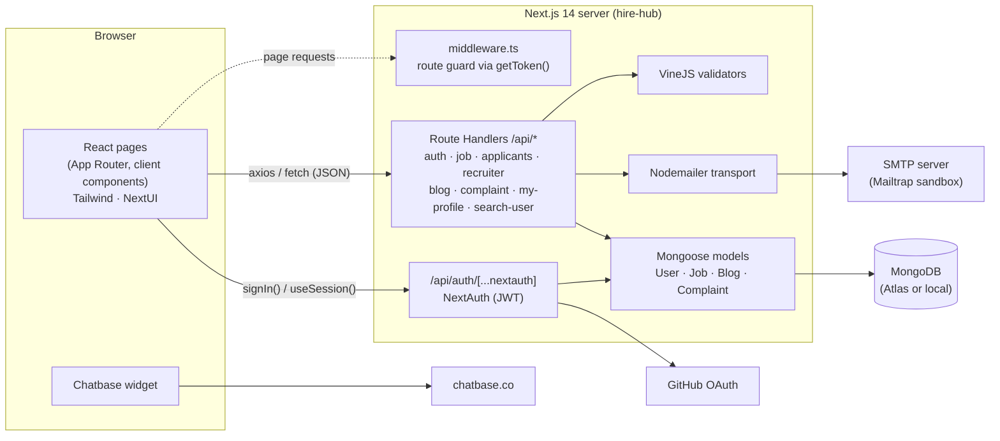
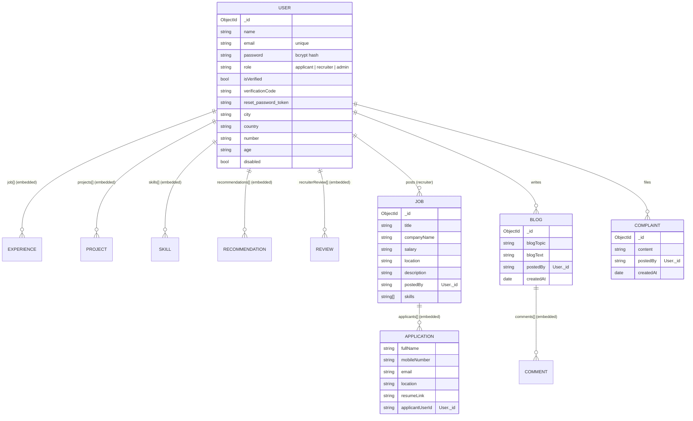
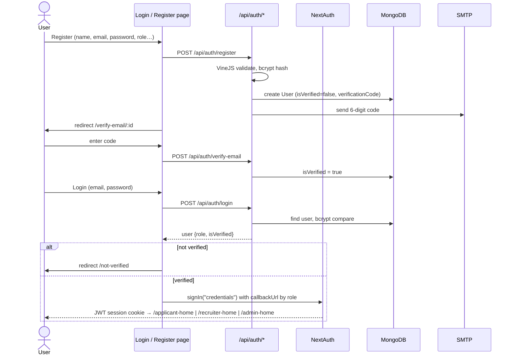

# Jobify

Jobify is a full-stack online recruitment platform built with **Next.js 14 (App Router)**, **MongoDB** and **NextAuth**. Recruiters post jobs and review applicants. Applicants build a profile, get skill-matched job suggestions and apply. Everyone can write blogs, comment, search for other users and send feedback to the admin.

---

## Features

### Applicants
- Register with email verification (6-digit code), then log in with email/password or GitHub.
- Build a profile with work experience, projects, skills and location.
- Browse all jobs, open job details and **apply** with name, phone, email, location and résumé link.
- **Suggested jobs**: jobs ranked by how many of the applicant's skills match the job's required skills.
- **In-demand jobs**: jobs ranked by number of applicants.
- View recruiter profiles and leave a **recruiter review**.
- View **recommendations** written by recruiters.

### Recruiters
- Post jobs with title, company, salary, location, description and required skills.
- View their own job posts and the applicants for each one.
- Write a **recommendation** on an applicant's profile.
- Public recruiter profile page.

### Everyone
- **Blogs**: create, edit, delete and view; view your own posts; comment on posts.
- **User search**: case-insensitive search by name or email.
- **Complaints / feedback**: users submit, the admin reviews them all.
- **Forgot / reset password** through a signed email link.
- **Disable account**: deletes the user together with their blogs and job posts.
- Embedded **Chatbase** chatbot on the landing and home pages.

### Admin
- Admin home page with links to post jobs, write blogs, search users and **view all complaints**.

---

## Tech Stack

| Layer | Technology |
|---|---|
| Framework | [Next.js 14.1](https://nextjs.org/) (App Router, Route Handlers), React 18, TypeScript / JSX |
| UI | Tailwind CSS, [NextUI](https://nextui.org/), RippleUI, CSS/SCSS Modules, Framer Motion |
| Forms & feedback | react-hook-form, react-hot-toast, react-toastify |
| HTTP client | axios, `fetch` |
| Auth | [NextAuth.js v4](https://next-auth.js.org/) (Credentials + GitHub OAuth, JWT sessions), bcryptjs |
| Validation | [VineJS](https://vinejs.dev/) with a custom error reporter |
| Database | MongoDB with [Mongoose 8](https://mongoosejs.com/) |
| Email | Nodemailer (SMTP, Mailtrap sandbox in development), react-email templates |
| Crypto | `cryptr` (encrypts the email in reset links), `crypto-random-string` (reset tokens) |
| Chatbot | [Chatbase](https://www.chatbase.co/) embed script |

---

## Software Architecture

Jobify is a single **Next.js monolith**. The same project serves the React UI (`src/app/**/page.tsx`) and the REST-style backend (`src/app/api/**/route.ts`). The route handlers talk to MongoDB through Mongoose models. Nothing in the backend runs as a separate service.



### Layers

| Layer | Location | Responsibility |
|---|---|---|
| **Pages (UI)** | `src/app/**/page.tsx`, `src/components/` | Client components. They fetch data from `/api/*` with axios or `fetch` and read the session with `useSession()`. Route groups `(auth)` and `(home-page)` organise login/registration screens and the role-specific home pages. |
| **API (Route Handlers)** | `src/app/api/**/route.ts` | Stateless JSON endpoints. Each handler connects to MongoDB, runs Mongoose queries and returns `NextResponse.json`. Dynamic segments such as `[id]` and `[userId]` carry resource IDs. |
| **Auth** | `src/app/api/auth/[...nextauth]/options.ts`, `src/middleware.ts` | NextAuth with a Credentials provider and a GitHub provider. Sessions are JWTs, and `role` is stored on the token. The middleware redirects unauthenticated users away from protected paths. |
| **Validation** | `src/validator/` | VineJS schemas for register and login, with a JSON:API-style `ErrorReporter`. |
| **Data** | `src/models/`, `src/database/mongo.config.ts` | Mongoose schemas and a shared `connect()` helper that reads `MONGO_URI`. |
| **Email** | `src/emails/`, `src/config/mail.ts` | Nodemailer transport. Sends the sign-up verification code and the password-reset link (rendered with react-email). |

### Data model

The data lives in MongoDB. Related records are mostly **embedded** inside a parent document, and references between documents are stored as string IDs.



> `prisma/schema.prisma` is left over from an earlier experiment. The app does **not** use Prisma. All data access goes through Mongoose.

### Authentication flow



Password reset works like this. `POST /api/auth/forgot-password` stores a 64-character random token on the user and emails a link of the form `/reset-password/<cryptr-encrypted email>?signature=<token>`. `POST /api/auth/reset-password` decrypts the email, matches the token and saves the new bcrypt hash.

### Job suggestion logic

`GET /api/applicants/[id]/suggested-jobs` lower-cases the applicant's skills (comma-separated entries are split) and each job's `skills[]`. It counts the overlap for each job, drops jobs with zero matches and sorts the rest by match count, highest first.

`GET /api/applicants/[id]/demand-jobs` uses an aggregation pipeline. It keeps jobs that have at least one applicant and sorts them by `$size: "$applicants"`.

---

## API Reference

All endpoints live under `/api` and exchange JSON.

<details>
<summary><b>Auth</b></summary>

| Method | Endpoint | Description |
|---|---|---|
| POST | `/auth/register` | Create an account and email a verification code |
| POST | `/auth/verify-email` | Verify the account with `{ email, verificationCode }` |
| POST | `/auth/login` | Check credentials and return the user (the client then calls NextAuth `signIn`) |
| POST | `/auth/forgot-password` | Email a password-reset link |
| POST | `/auth/reset-password` | Reset the password with the encrypted email and signature |
| GET/POST | `/auth/[...nextauth]` | NextAuth handlers (session, callback, signout, …) |
</details>

<details>
<summary><b>Jobs</b></summary>

| Method | Endpoint | Description |
|---|---|---|
| POST | `/job` | Create a job post |
| GET | `/job/getJobs` | List all jobs |
| GET | `/job/[id]` | Get one job |
| GET | `/job/[id]/view-job-details` | Job details |
| POST | `/job/apply` | Apply to a job (pushes into `applicants[]`) |
| POST | `/job/delete-job` | Delete a job |
</details>

<details>
<summary><b>Applicants</b></summary>

| Method | Endpoint | Description |
|---|---|---|
| GET | `/applicants/[id]/profile` | Applicant profile |
| GET | `/applicants/[id]/job` | Jobs list for the applicant |
| GET | `/applicants/[id]/suggested-jobs` | Skill-matched job suggestions |
| GET | `/applicants/[id]/demand-jobs` | Jobs ranked by applicant count |
| GET | `/applicants/recruiter` | List recruiters |
</details>

<details>
<summary><b>Recruiters & recommendations</b></summary>

| Method | Endpoint | Description |
|---|---|---|
| GET | `/recruiter/[id]/profile` | Recruiter profile |
| GET | `/recruiter/[id]/view-my-jobs` | Jobs posted by the recruiter |
| GET | `/recruiter/[id]/applicants` | Applicants for the recruiter's job |
| POST | `/recruiter/add-reco/[recruiterId]/[applicantId]` | Add a recommendation to an applicant |
| POST | `/recruiter/review/[id]` | Add a review to a recruiter |
| GET | `/reco/[id]` | Recommendations for a user |
</details>

<details>
<summary><b>My profile</b></summary>

| Method | Endpoint | Description |
|---|---|---|
| POST | `/my-profile` | Get the current user's profile by `{ id }` |
| GET | `/my-profile/[id]` | Get a profile by ID |
| POST | `/my-profile/add-job` | Add work experience |
| POST | `/my-profile/add-project` | Add a project |
| POST | `/my-profile/add-skill` | Add a skill |
| POST | `/my-profile/add-location` | Update city / country |
| POST | `/my-profile/disable-account` | Delete the account with its blogs and jobs |
</details>

<details>
<summary><b>Blogs, complaints, search</b></summary>

| Method | Endpoint | Description |
|---|---|---|
| POST | `/blog/[userId]/create-blog` | Create a blog post |
| GET | `/blog/[userId]/view-blogs` | All blogs, with author names |
| GET | `/blog/[userId]/view-own-blogs` | The user's own blogs |
| GET | `/blog/[userId]/[blogId]/view-blog` | One blog |
| PUT | `/blog/[userId]/[blogId]/edit-blog` | Edit a blog |
| DELETE | `/blog/[userId]/[blogId]/delete-blog` | Delete a blog |
| POST | `/blog/comment/[commentBy]/[blogId]/post-comment` | Comment on a blog |
| GET | `/blog/comment/[commentBy]/[blogId]/view-comments` | View comments |
| POST | `/complaint/[userId]/add-complaint` | Submit a complaint |
| GET | `/complaint/[userId]/view-my-complaints` | The user's complaints |
| GET | `/complaint/view-complaints` | All complaints (admin) |
| GET | `/search-user?search=<term>` | Search users by name or email |
</details>

---

## Project Structure

```
Jobify/
├── README.md
└── hire-hub/                       # Next.js application
    ├── package.json
    ├── next.config.mjs
    ├── tailwind.config.ts
    ├── prisma/schema.prisma        # unused (see note above)
    └── src/
        ├── middleware.ts           # route protection (NextAuth JWT)
        ├── types.ts                # shared payload / error types
        ├── app/
        │   ├── layout.tsx          # root layout, NextUI + Session providers
        │   ├── page.tsx            # landing page
        │   ├── (auth)/             # login, register, verify-email, forgot/reset password
        │   ├── (home-page)/        # applicant-home, recruiter-home, admin-home
        │   ├── applicants/         # profile, public profile, jobs, suggested/demand jobs, recos
        │   ├── recruiter/          # job-post, profile, my jobs, applicants, add recommendation
        │   ├── job/                # job list and details / apply
        │   ├── blog/               # create, edit, list, comments
        │   ├── complaint/          # add / view complaints
        │   ├── search-user/
        │   └── api/                # backend Route Handlers (see API Reference)
        ├── components/             # Nav variants, ApplyJob, ProfileBlog, Toast, Bot
        ├── models/                 # Mongoose: User, Job, Blog, Complaint
        ├── database/mongo.config.ts
        ├── validator/              # VineJS schemas + ErrorReporter
        ├── emails/                 # mailer + react-email templates
        ├── config/                 # env + SMTP transport
        └── style/                  # CSS / SCSS modules
```

---

## Getting Started

### Prerequisites

- **Node.js 18.17+** (required by Next.js 14) and npm
- A **MongoDB** database: a free [MongoDB Atlas](https://www.mongodb.com/atlas) cluster or a local `mongod`
- A **Mailtrap** (or any SMTP) inbox to receive verification and reset emails
- *(Optional)* a **GitHub OAuth App** for "Login with GitHub"

### 1. Clone and install

```bash
git clone https://github.com/sreya-majumder/Jobify.git
cd Jobify/hire-hub
npm install
```

### 2. Configure environment variables

Create `hire-hub/.env.local`. This filename is git-ignored, so secrets stay out of the repo.

```env
# --- Database ---
MONGO_URI=mongodb+srv://<user>:<password>@<cluster>.mongodb.net/jobify
# or local: MONGO_URI=mongodb://127.0.0.1:27017/jobify

# --- App / NextAuth ---
APP_URL=http://localhost:3000
NEXTAUTH_URL=http://localhost:3000
NEXTAUTH_SECRET=<a long random string>      # e.g. `openssl rand -base64 32`

# --- GitHub OAuth (optional) ---
GITHUB_CLIENT_ID=<your GitHub OAuth client id>
GITHUB_CLIENT_SECRET=<your GitHub OAuth client secret>

# --- Google OAuth (optional, provider is registered but no UI button) ---
GOOGLE_CLIENT_ID=
GOOGLE_CLIENT_SECRET=

# --- SMTP ---
SMTP_HOST=sandbox.smtp.mailtrap.io
SMTP_PORT=2525
SMTP_USER=<mailtrap username>
SMTP_PASSWORD=<mailtrap password>
SMTP_SECURE=false
EMAIL_FROM=no-reply@jobify.local
```

| Variable | Used by | Required |
|---|---|---|
| `MONGO_URI` | `database/mongo.config.ts` | ✅ |
| `NEXTAUTH_SECRET` | NextAuth JWT signing, `cryptr` in password reset | ✅ |
| `NEXTAUTH_URL`, `APP_URL` | NextAuth callbacks, reset-link base URL | ✅ |
| `GITHUB_CLIENT_ID/SECRET` | GitHub sign-in | optional |
| `SMTP_*`, `EMAIL_FROM` | `config/mail.ts` | see note below |

> **Email transport note.** The verification email (`src/emails/mailer.ts`) and the forgot-password email (`src/app/api/auth/forgot-password/route.ts`) currently create their **own** Nodemailer transports with hard-coded Mailtrap sandbox settings. They do not read the `SMTP_*` variables. To receive these emails in your own inbox, replace those two transport configs with the shared `transporter` from `src/config/mail.ts`, or paste in your own Mailtrap credentials.

For the GitHub OAuth App, set the callback URL to `http://localhost:3000/api/auth/callback/github`.

### 3. Run the development server

```bash
npm run dev
```

Open <http://localhost:3000>.

### 4. Create accounts

1. Go to **Sign Up**, fill in the form and choose a role: **Applicant** or **Recruiter**.
2. Enter the 6-digit code from the verification email (check your Mailtrap inbox).
3. Log in. You land on `/applicant-home` or `/recruiter-home`, depending on your role.

**Admin account.** The sign-up form offers no Admin role. To create an admin, register a normal user, then set `role` to `"admin"` and `isVerified` to `true` on that user's document in MongoDB (with Atlas UI, Compass, or `mongosh`):

```js
db.users.updateOne({ email: "admin@example.com" }, { $set: { role: "admin", isVerified: true } })
```

### 5. Production build

```bash
npm run build
npm start
```

### Available scripts

| Script | Description |
|---|---|
| `npm run dev` | Start the dev server with hot reload on port 3000 |
| `npm run build` | Create an optimised production build |
| `npm start` | Serve the production build |
| `npm run lint` | Run ESLint (`next lint`) |

---

## Troubleshooting

| Problem | Fix |
|---|---|
| `Module not found: Can't resolve '@/components/bot'` on Linux / Vercel | The file is `components/Bot.tsx`, but several pages import `@/components/bot`. Windows and macOS ignore case, so it works there. Linux does not. Change the imports to `@/components/Bot`. |
| Pages show no data after deployment | About a dozen client pages call `http://localhost:3000/api/...` directly. Replace those with relative URLs (`/api/...`). |
| `MongoDB connection error` and the server exits | Check `MONGO_URI`, and whitelist your IP in Atlas **Network Access**. |
| No verification email arrives | See the email transport note above. The code is also saved in the user's `verificationCode` field in MongoDB, so you can read it from there. |
| Login with GitHub fails | Check that the OAuth callback URL matches `NEXTAUTH_URL` and that `NEXTAUTH_SECRET` is set. |

---

## Contributors

Developed by **Zawad**, **Rupkatha** and **Sreya**.

- Zawad: [@HypnoSphynx](https://github.com/HypnoSphynx)
- Rupkatha: [@rupkatha6005](https://github.com/rupkatha6005)
- Sreya: [@sreya-majumder](https://github.com/sreya-majumder)
